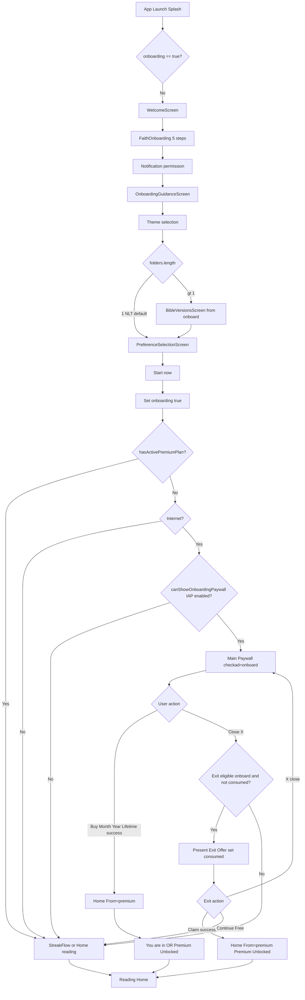
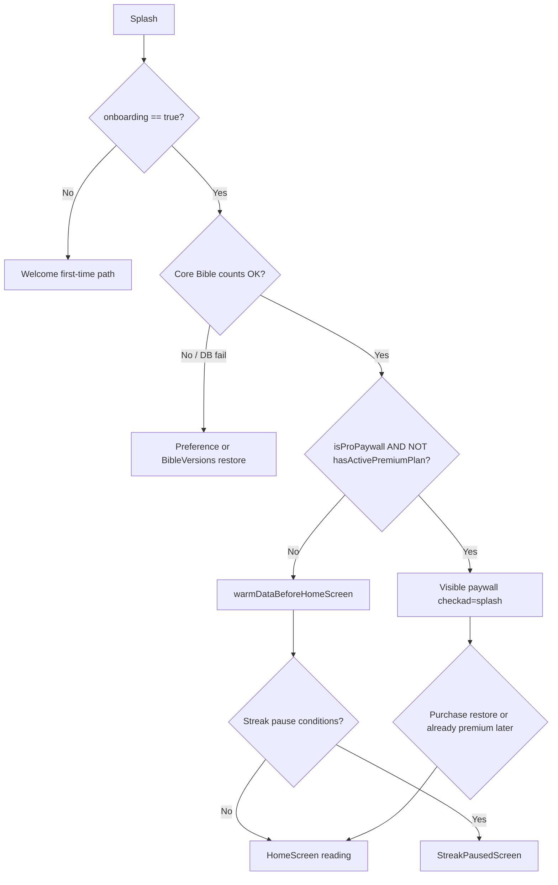
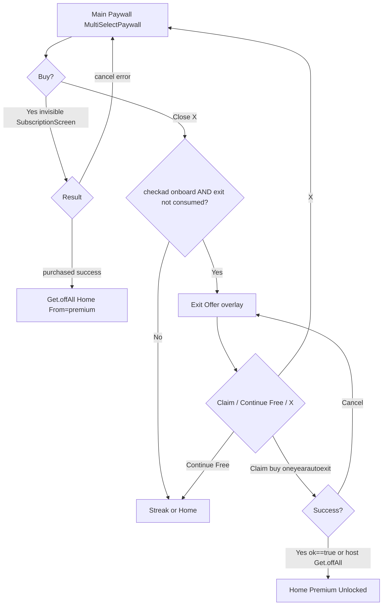
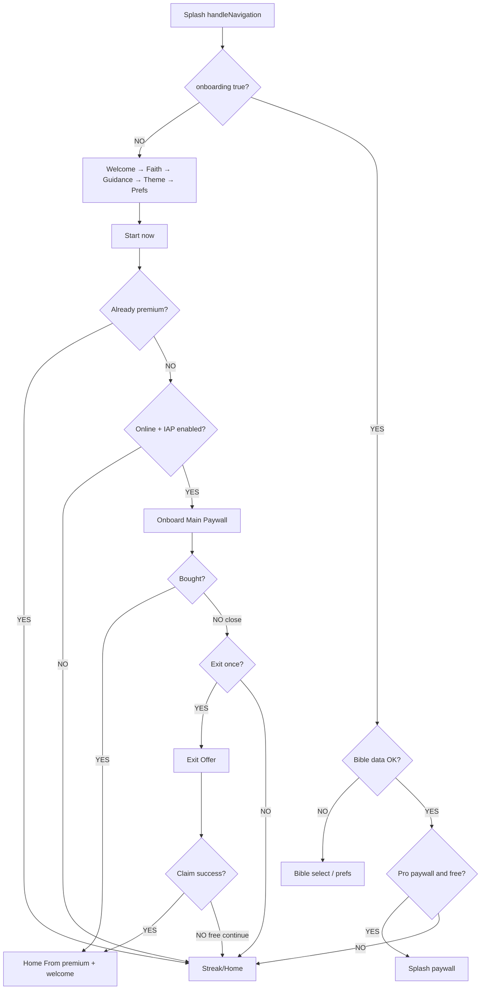

# Old Paper NLT Bible — User Flow Audit

**Project:** Old Paper NLT Bible (Flutter iOS)  
**Scope:** Inspection only — no code was modified for this report.  
**Source of truth:** Current repository implementation (static analysis).  
**Default paywall mode in code:** `BibleInfo.paywallShows = 1` → `MultiSelectPaywall` + auto-renewable product IDs.

Behaviors that cannot be confirmed without a device/StoreKit session are marked **Requires Runtime Verification**.

---

## 1. Executive Summary

### Actual first-time journey (default `paywallShows == 1`, single Bible folder)

1. **Splash** (`splash.dart` → `handleNavigation`)
2. If `SharPreferences.onboarding` is null/false → **WelcomeScreen**
3. **FaithOnboardingScreen** (5 question steps) → notification permission → **OnboardingGuidanceScreen** → **OnboardingThemeSelectionScreen**
4. **PreferenceSelectionScreen** (NLT only — `BibleInfo.folders = ["NLT Bible"]`)
5. **Start now** sets `onboarding = true`, then (if online + dashboard IAP enabled) **Main Paywall** with `checkad: 'onboard'`
6. Close on Main Paywall (once) → **Exit Offer** overlay (`oneyearautoexit`), only when `checkad == 'onboard'`
7. Exit **Continue with Free Version** / second close after exit consumed → **StreakFlow or Home** (reading)
8. Purchase success (Main or Exit) → `HomeScreen(From: "premium")` → welcome popup (**You're in** for trial SKUs / **Premium Unlocked** for Lifetime & Exit) → reading

### Actual returning-user journey (onboarding already true)

- Splash validates core Bible DB counts.
- If `isProPaywall` (`paywallShows == 2`) and not premium → force visible paywall (`checkad: 'splash'`).
- Otherwise → `StreakFlowNavigation.navigateToStreakFlowOrHome` → usually **Home** (reading). Streak pause screen only in specific missed-streak cases.
- **Onboarding Main Paywall / Exit Offer are not re-shown on cold start** for free users when `paywallShows == 1`.

### Key product IDs (as coded)

| Role | Product ID constant |
|------|---------------------|
| Main short plan (AR mode) | `com.balaklrapps.newlivingtranslation.onemonthauto` |
| Main yearly (AR mode) | `com.balaklrapps.newlivingtranslation.oneyearauto` |
| Lifetime | `com.balaklrapps.newlivingtranslation.lifetimeadsfree` |
| Exit offer yearly | `com.balaklrapps.newlivingtranslation.oneyearautoexit` |

Exit offer **does** use a **separate** product ID (`oneyearautoexit`), not the regular yearly SKU.

---

## 2. First-Time User Flow (Answers)

| Question | Implemented answer | Evidence |
|----------|-------------------|----------|
| Screen after launch | Splash, then routing in `handleNavigation` | `lib/view/screens/auth/splash.dart` ~840–935 |
| Splash conditions | Notification payload store; welcome logo flag; `onboarding` bool; Bible verse/book counts; optional Pro paywall gate | same |
| First-launch detection | `SharPreferences.onboarding` null/false → first-time path | splash.dart ~844–851 |
| Onboarding screens / order | Welcome → Faith (5 steps) → Guidance → Theme → Preferences (Start now) | `welcome_screen.dart` ~107–108; `onboard_faith_screen.dart` ~186–217 |
| Complete onboarding | `onboarding=true` only on Preference **Start now** (onboard path) | `preference_selection_screen.dart` ~1632–1634 |
| Skip onboarding | No dedicated “skip all onboarding” in this path. Force-close before Start now → onboarding stays incomplete → Welcome again | Comments in `onboard_faith_screen.dart` ~187–201 |
| When Main Paywall appears | After Start now if not already premium, has internet, and `canShowOnboardingPaywall()` | preference_selection_screen.dart ~1636–1682 |
| Plans displayed (`paywallShows==1`) | AI card duration toggle maps to **1 Month AR** + **1 Year AR** + **Lifetime** card | `paywall_navigation.dart` ~22–28; `multi_select_paywall.dart` `_AiDur` / `_PwCard` |
| Monthly / Yearly / Lifetime select | Invisible `SubscriptionScreen` host buys selected slot | multi_select_paywall.dart `_startPurchase` |
| Close Main Paywall | If exit not consumed and `checkad=='onboard'` → present Exit; else leave to streak/home | multi_select_paywall.dart `_onClose` ~803–815 |
| Exit offer conditions | Only onboard paywall; once per install via `ms_exit_offer_consumed`; session `_exitOfferShownOnce` | multi_select_paywall.dart ~118, 151–164 |
| Accept Exit | Claim → buy `exitOfferPlanid` on Exit UI; success → Home `From:premium` | `_claimExitGift`, `_startExitOfferPurchase` |
| Decline Exit | ✕ returns to Main Paywall; **Continue with Free Version** leaves to streak/home | `_onClose`; exit CTA ~2607–2610 |
| Reach reading | `StreakFlowNavigation._goToHome` / `HomeScreen`; purchase path `From: "premium"` | streak_flow_screens.dart; multi_select_paywall.dart ~492–499 |
| Stuck routes | Possible if IAP host fails without pop; Exit success that `Get.offAll`s without `ok==true` may not re-handoff from MultiSelect | **Requires Runtime Verification**; see Bugs |

---

## 3. Returning User Flow (by scenario)

| Scenario | Onboarding again? | Main paywall on launch? | Exit on launch? | Entitlement check? | After splash | Can read? |
|----------|-------------------|-------------------------|-----------------|---------------------|--------------|-----------|
| Free, finished onboarding, never bought | No | No (`paywallShows==1`) | No | `hasActivePremiumPlan` only if Pro mode / other entry points | Streak/Home | Yes (free) |
| Free, dismissed Main Paywall | No | No on relaunch | No on relaunch (`ms_exit_offer_consumed` may already be true) | Local prefs | Streak/Home | Yes |
| Free, dismissed Exit | No | No | No (consumed pref) | Local prefs | Streak/Home | Yes |
| Active Monthly (`silver` + future expiry) | No | No | No | Splash doesn’t re-validate StoreKit; uses local expiry/plan | Home | Yes |
| Active Yearly (`gold`) | No | No | No | Local | Home | Yes |
| In free trial | No dedicated “trial” flag at splash; trial UX uses last product + free-until prefs after buy | No | No | Local expiry | Home | Yes — **Requires Runtime Verification** for Store trial state |
| Lifetime (`platinum` / far expiry) | No | No | No | Local | Home | Yes |
| Expired (expiry ≤ now) | No | No (unless Pro paywall mode) | No | `hasActivePremiumPlan` false | Home free | Yes free |
| Cancelled but period active | Treated as premium while local expiry in future | No | No | Local only — **Requires Runtime Verification** vs App Store | Home | Yes while local expiry valid |
| Restore pending/fail | Not on splash; Restore is paywall/wallet action | N/A | N/A | Purchase stream / restore handlers | Unchanged | **Requires Runtime Verification** |
| Force-close mid-onboarding | Yes (Welcome) if `onboarding` still false | N/A | N/A | N/A | Welcome | Blocked until complete |
| Force-close on paywall | Onboarding already true after Start now | Not auto on relaunch (`paywallShows==1`) | Only if consumed not set | Local | Home | Yes |
| Offline reopen | Same routing; onboard paywall skipped offline at Start now; stacked paywall toasts offline | Offline toast if opening stacked paywall later | N/A | Local | Home if onboarded | Yes |

**Pro mode note:** If `paywallShows == 2`, every non-premium splash launch opens paywall (`checkad: 'splash'`) — splash.dart ~912–924.

---

## 4. Paywall & Exit Offer Integration

### Main paywall (`paywallShows == 1`)

- UI: `MultiSelectPaywall`
- IAP: invisible `SubscriptionScreen` (`invisiblePurchaseHost: true`)
- Short slot product: **AR 1 Month** (`onemonthauto`) — enum name `_AiDur.sixMonth` is legacy naming
- Year slot: **AR 1 Year** (`oneyearauto`)
- Lifetime: `lifetimeadsfree`
- Success: `Get.offAll(HomeScreen(From: "premium"))` + `premiumalrt='1'` → `PremiumWelcomeAlert` / `TrialStartedAlert`
- Trial eligibility on Apple sheet: **StoreKit / ASC** — app does not invent intro offers in code. **Requires Runtime Verification**

### Exit offer

- **Separate SKU:** `oneyearautoexit`
- Enabled only when `widget.checkad == 'onboard'`
- Consumed flag: `ms_exit_offer_consumed` set when Exit is **presented**
- Discount display: Store intro/renew pair and/or API `exitOfferPlanDiscount` (default `"25"`)
- Claim keeps Exit visible under Processing/sheet (does not flash Main Paywall)
- Success: Home + **Premium Unlocked** (Exit excluded from trial “You're in” flow)
- ✕ on Exit → back to Main Paywall (does not leave app)
- Continue Free → leave to streak/home

### Duplicate / loop risks

- Exit cannot show twice in same install after present (consumed pref) — by design
- Exit cannot show after successful Main purchase if navigation already left paywall
- Double Home handoff guarded by `_purchaseSuccessHandoffDone`

---

## 5. Navigation & State Persistence

| Concern | Mechanism | Key / location |
|---------|-----------|----------------|
| First launch / onboarding done | SharedPreferences via `SharPreferences` | `onboarding` |
| Splash routing | `SplashScreen.handleNavigation` | splash.dart |
| Paywall show (onboard) | `onboarding=true` + internet + `canShowOnboardingPaywall` | preference_selection_screen; `isSubscriptionEnabled` |
| Exit show | `checkad=='onboard'` + not `ms_exit_offer_consumed` | multi_select_paywall |
| Entitlement | `subscription_plan`, `isRewardAdViewTime` | SharedPreferences; `BibleInfo.hasActivePremiumPlan` |
| Last IAP product | `last_iap_product_id` (+ iOS keychain channel) | SubscriptionScreen / PremiumEntitlementLabelSync |
| Welcome after buy | `premiumalrt`, `deferUpgradeAlert` | prefs |
| Reading destination | `HomeScreen` / streak → Home | streak_flow_screens.dart |
| Bible content | SQLite via `DBHelper` | splash count check |

**Persistence notes**

- Survives restart: SharedPreferences flags/expiry/plan.
- Reinstall: prefs cleared; StoreKit may still own subscriptions — restore path exists; auto-entitlement on splash is **local-only** → **Requires Runtime Verification**.
- App update: may reset `onboarding` false for certain old→new upgrades (`_updateWelcomeLogoComparisonFlag`).

**Race conditions (code-supported)**

- Purchase stream vs 6s abandon timer / lifecycle resume can dismiss invisible host early.
- Buy apply requires `_buySheetStarted && matchesBuy` to avoid pre-sheet grant.
- Exit MultiSelect handoff only if `ok == true` (no entitlement fallback) — if host only `Get.offAll`s, OK; if host pops null after failed navigate, user may remain on paywall (**Requires Runtime Verification**).

---

## 6. Flow Diagrams (Actual Implementation)

### Diagram A — First-Time User

### Diagram B — Returning User

### Diagram C — Paywall and Exit Offer

### Diagram D — Complete App Launch Decision Tree

---

## 7. Screen-by-Screen Navigation Table

| # | Screen | Next (typical) | Trigger |
|---|--------|----------------|---------|
| 1 | Splash | Welcome or Home/Paywall | `handleNavigation` |
| 2 | WelcomeScreen | FaithOnboardingScreen | Continue |
| 3 | FaithOnboardingScreen | Guidance (after 5 answers) | Continue |
| 4 | OnboardingGuidanceScreen | Theme selection | Continue |
| 5 | OnboardingThemeSelectionScreen | PreferenceSelection / BibleVersions | Theme chosen |
| 6 | BibleVersionsScreen | PreferenceSelection | onboard only if multi-bible |
| 7 | PreferenceSelectionScreen | Paywall or Streak/Home | Start now |
| 8 | MultiSelectPaywall | Exit / Home / Streak | Buy / Close |
| 9 | Exit overlay | Main Paywall / Home | X / Continue Free / Claim |
| 10 | HomeScreen | Reading UI | Default destination |
| 11 | StreakPausedScreen | Home | Only streak-pause branch |

---

## 8. Subscription & Onboarding State Conditions

| State | Condition (code) |
|-------|------------------|
| Onboarding incomplete | `onboarding != true` |
| Onboarding complete | `onboarding == true` (set at Start now) |
| Premium active | Future `isRewardAdViewTime` + plan silver/gold/twoyear/platinum (or long expiry without plan with >3 day rule) |
| Free | Not `hasActivePremiumPlan()` |
| Trial UX after buy | Last product is Month/Year AR (not Lifetime, not Exit) → You're in |
| Exit UX after buy | Last product Exit → Premium Unlocked, Manage Premium yearly |
| Lifetime UX | platinum / lifetime id / far expiry → Lifetime Manage Premium |
| Exit eligible | `checkad=='onboard'` && `ms_exit_offer_consumed != true` && not shown this session |

---

## 9. Bugs, Risks & Missing Integrations

| Sev | Issue | File / symbol | Lines (approx) | Explanation | Expected | Recommendation |
|-----|-------|---------------|----------------|-------------|----------|----------------|
| High | Exit success handoff only if `Navigator.pop(true)`; host often `Get.offAll` without pop | `multi_select_paywall.dart` `_startExitOfferPurchase` | ~852–857 | If `Get.offAll` fails/`!mounted` race, MultiSelect may not hand off | Always reach Home + Premium Unlocked after Exit buy | Keep host `Get.offAll`; add safe fallback when entitlement newly granted **after** `_buyDaysApplied` only |
| Medium | Splash does not refresh StoreKit entitlement | `BibleInfo.hasActivePremiumPlan` | constants.dart ~125–139 | Relies on local prefs; reinstall/device restore may look free until Restore | Returning paid user recognized | Document Restore; optional receipt refresh — **Requires Runtime Verification** |
| Medium | `_AiDur.sixMonth` buys **1 Month AR**, not 6-month | `paywall_navigation.dart` / multi_select | ~22–25, enum | Naming mismatch can confuse QA | Labels match SKU | Align naming/copy with `onemonthauto` |
| Medium | Exit consumed when **shown**, not when resolved | `_presentExitOffer` | ~157–159 | Force-kill on Exit still consumes; Exit won’t return | Product decision | Confirm with PM; optionally consume on leave/claim only |
| Low | Legacy `OnboardingScreen` / `FreeTrialIntroScreen` exist but are **not** on default Welcome→Faith path | various | — | Dead/alternate entry points | Clear which path is production | Keep docs pointing at Faith path |
| Low | Classic `SubscriptionScreen` exit-offer bottom sheet (API) differs from MultiSelect Exit | `intro_subcribtion_screen.dart` | exit bottom sheet | Only when visible SubscriptionScreen / non-multi | Consistent Exit UX | N/A when `paywallShows==1` |
| — | Apple 3-day trial on sheet | ASC / StoreKit | — | Not controlled in Flutter beyond product ID | Trial shows for eligible AR yearly/monthly | **Requires Runtime Verification** |
| — | Network flaky “low data” Rate Us / paywall | about / paywall_navigation | — | InternetConnection probe | Toast when unreachable | **Requires Runtime Verification** |

**Do not treat as bugs without evidence**

- Streak pause diverting some returning users away from Home immediately — implemented intentionally.
- Exit ✕ returning to Main Paywall — implemented intentionally.

---

## 10. Source File Index

| Area | Path |
|------|------|
| Splash routing | `lib/view/screens/auth/splash.dart` |
| Welcome | `lib/view/screens/welcome_screen.dart` |
| Faith onboarding | `lib/view/screens/onboard_faith_screen.dart` |
| Guidance | `lib/view/screens/onboarding_guidance_screen.dart` |
| Preferences / Start now | `lib/view/screens/dashboard/preference_selection_screen.dart` |
| Bible versions | `lib/view/screens/bible_select_screen.dart` |
| Paywall router | `lib/view/screens/paywall_navigation.dart` |
| Main/Exit UI | `lib/view/screens/multi_select_paywall.dart` |
| IAP host | `lib/view/screens/intro_subcribtion_screen.dart` |
| Product IDs / entitlement | `lib/view/screens/dashboard/constants.dart` |
| Prefs keys | `lib/view/constants/share_preferences.dart` |
| Onboard paywall gate | `lib/services/paywall_preload_service.dart` |
| Home + welcome alerts | `lib/view/screens/dashboard/home_screen.dart` |
| Trial vs Premium Unlocked | `lib/services/trial_reminder_ux.dart`, `trial_started_alert.dart` |
| Streak/Home | `lib/streak_flow/streak_flow_screens.dart` |
| Manage Premium | `lib/view/screens/dashboard/manage_premium_screen.dart` |

---

## 11. QA Test Cases (Real iPhone)

1. **Fresh install** — Splash → Welcome → complete Faith/Theme/Prefs → Start now → Main Paywall.
2. **Start now offline** — Skip paywall → reach Home/reading.
3. **Main Paywall buy Yearly (sandbox eligible)** — Processing → success → Home → You're in → Start Reading → reading; Premium Active → Manage Premium yearly/trial UI.
4. **Main Paywall buy Lifetime** — Home → Premium Unlocked (not You're in); Manage Premium Lifetime; no info `i`.
5. **Close Main Paywall once** — Exit Offer appears; `ms_exit_offer_consumed` set.
6. **Exit ✕** — Returns to Main Paywall (not Home).
7. **Exit Continue Free** — Leaves to reading; Exit not shown again on relaunch.
8. **Exit Claim** — Stay on Exit under sheet; success → Premium Unlocked; Premium Active → Yearly Exit Manage Premium (not Lifetime).
9. **Relaunch free after dismiss** — No onboarding; no Exit; Home/reading.
10. **Relaunch premium** — Home; no onboard paywall.
11. **Force-close mid-Faith** — Relaunch Welcome (onboarding false).
12. **Force-close on Main Paywall after Start now** — Relaunch Home (onboarding true); paywall not forced (`paywallShows==1`).
13. **Restore** — From paywall/wallet; entitlement updates — **Requires Runtime Verification**.
14. **Settings Plan details Lifetime** — Shows “Lifetime access”, not year 58002.
15. **About Us Rate Us offline/low data** — Toast “Check your internet connection”.

---

## 12. Inspection Statement

This report was produced by **static analysis of the current Flutter codebase only**. No application code was modified as part of this audit. Runtime StoreKit, ASC introductory offers, sandbox account eligibility, and device-specific networking must be validated on a physical iPhone where marked **Requires Runtime Verification**.
